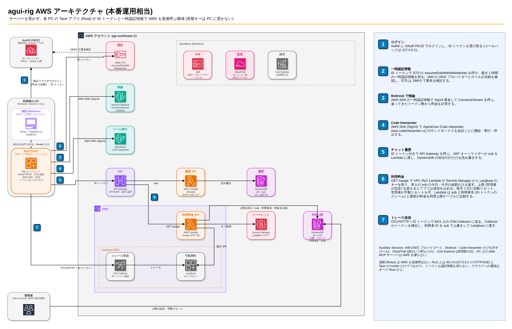
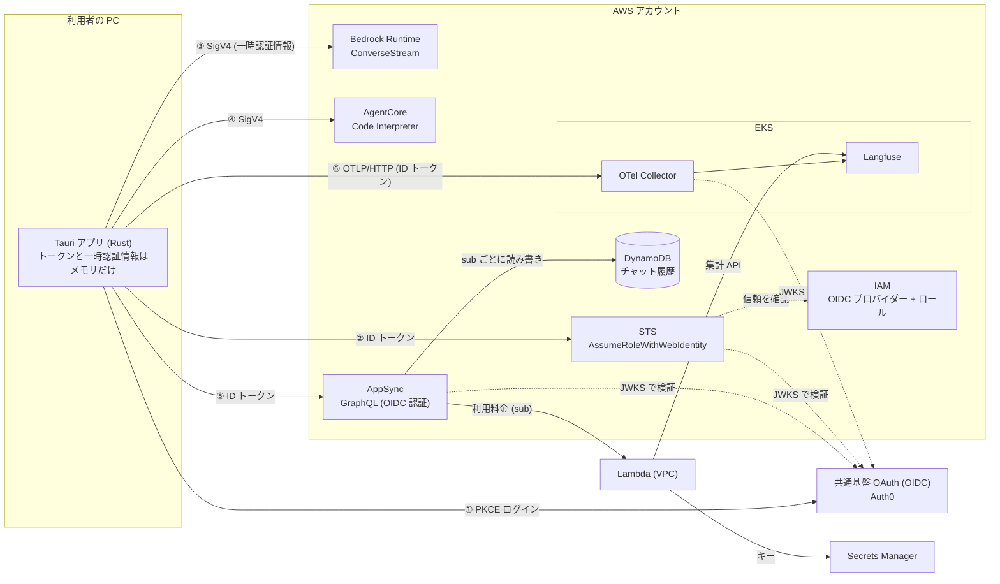

# agui-rig

React + CopilotKit のチャット UI を Tauri 2 のデスクトップアプリ (Windows / macOS / Linux) に載せ、エージェントを Rust の Rig で動かすアプリです。

- **モデル**: Amazon Bedrock (Rig の `rig-bedrock`)
- **認証**: 共通基盤の OAuth (OpenID Connect) でログインし、ID トークンを STS `AssumeRoleWithWebIdentity` で一時 IAM 認証情報に交換。長期のアクセスキーは使わない
- **ツール**: Amazon Bedrock AgentCore Code Interpreter と、PC 上で起動する stdio MCP サーバー
- **チャット履歴**: AWS AppSync (OpenID Connect 認証) 経由で DynamoDB に保存。利用者は自分の会話だけを読み書きできる
- **画面**: shadcn/ui (Tailwind CSS v4) と CopilotKit v2 のチャット。OS の設定に合わせてライト / ダークを切り替える
- **画面との接続**: AG-UI プロトコル。フロントは `@ag-ui/client` の `HttpAgent` で Rust の AG-UI エンドポイントに直接つなぐ (CopilotKit の Node ランタイムは使わない)

## 構成


画面の CopilotKit (`CopilotKitProvider` と `CopilotChat`) は、CopilotKit の Node ランタイムを使わず、
`selfManagedAgents` に登録した `HistoryAgent` (AG-UI の `HttpAgent` を拡張したもの) で Rust に直接つなぎます。

- ① 送信すると、`HistoryAgent` が会話と threadId を `RunAgentInput` にして `POST http://127.0.0.1:<port>/agent` に送る。URL と起動ごとの鍵は、最初に `invoke("agent_endpoint")` で受け取る
- ② Rust は Rig の実行の様子を AG-UI のイベント (`RUN_STARTED`、`TEXT_MESSAGE_*`、`TOOL_CALL_*`、`RUN_FINISHED`) にして SSE で返す。文章は `CopilotChat`、ツール呼び出しは `renderToolCalls` に登録した `ToolCallCard` が表示する
- 過去の会話を開くときは、`HistoryAgent.connect` が保存済みのメッセージを `MESSAGES_SNAPSHOT` として返して画面に復元する
- ログイン、会話一覧、利用料金は AG-UI ではなく、Tauri の `invoke` で Rust のコマンドを呼ぶ

<details>
<summary>テキスト版</summary>

```
┌───────────────────────── Tauri アプリ (1 プロセス) ─────────────────────────┐
│ WebView (React)                    Rust                                     │
│  CopilotChat ─ HttpAgent ─ POST /agent ─▶ axum (127.0.0.1) ─ AG-UI / SSE    │
│  ログイン画面 ─ invoke("login") ────────▶ OAuth (PKCE) ── ブラウザでログイン │
│                                           │ ID トークン                      │
│                                           ▼                                 │
│                                  STS AssumeRoleWithWebIdentity              │
│                                           │ 一時 IAM 認証情報                │
│                       Rig のツールループ ─┼─▶ Bedrock (ConverseStream)      │
│                                           ├─▶ AgentCore Code Interpreter    │
│                                           └─▶ stdio MCP サーバー (子プロセス)│
└─────────────────────────────────────────────────────────────────────────────┘
```

</details>

1. 「ログイン」で OS の既定ブラウザが開き、共通基盤でログインする。リダイレクトは `http://127.0.0.1:<port>/callback` で受ける (RFC 8252、クライアントシークレットなし)。
2. Rust が ID トークンを STS に渡して一時認証情報を得る。期限前に SDK が自動で取り直し、ID トークンもリフレッシュトークンで自動更新する。**トークンと認証情報は Rust のメモリ上だけに置き、WebView には渡さない。**
3. チャットを送ると、Rig がモデルを呼び、モデルがツールを呼べば実行して結果を返す、をツールを呼ばなくなるまで繰り返す (最大 10 回)。その様子は AG-UI のイベント (`TEXT_MESSAGE_*`、`TOOL_CALL_START / ARGS / END / RESULT`) で画面に流れ、ツール呼び出しはカードで表示される。

### ツール

| ツール名 (モデルから見える名前) | 内容 |
| --- | --- |
| `code_interpreter_execute_code` | AgentCore Code Interpreter でコードを実行 (Python / JavaScript / TypeScript) |
| `code_interpreter_execute_command` | 同じサンドボックスでシェルコマンドを実行 |
| `<サーバー名>__<ツール名>` | mcp.json に書いた stdio MCP サーバーのツール |

- Code Interpreter のセッションはチャットのスレッドごとに 1 つ作るので、同じスレッドでは変数やファイルが引き継がれる。ログアウトやアプリ終了で止める。
- MCP サーバーはアプリ起動時に子プロセスとして起動し、終了時に止める。**AWS の認証情報などを渡さないよう、環境変数は `PATH` など最小限だけ引き継ぐ** (必要なものは mcp.json の `env` に書く)。Windows では `npx` などのバッチファイルも動くよう `cmd /C` 経由で、コンソールウィンドウを出さずに起動する。

## AWS 構成

サーバーは置かず、各 PC のアプリ (Rust) が AWS を直接呼びます。AWS の長期キーは PC に置きません。



<details>
<summary>同じ図の Mermaid 版 (テキストで直すとき用)</summary>



</details>

| 通信 | 認証 | 用途 |
| --- | --- | --- |
| ① アプリ → 共通基盤 OAuth | Authorization Code + PKCE (シークレットなし) | ログイン、ID トークンとリフレッシュトークンの取得 |
| ② アプリ → STS | ID トークン | ロールの一時認証情報 (最大 1 時間、自動更新) |
| ③ アプリ → Bedrock | 一時認証情報 (SigV4) | モデルの呼び出し (ストリーミング) |
| ④ アプリ → AgentCore Code Interpreter | 一時認証情報 (SigV4) | コード実行 (会話ごとのサンドボックス) |
| ⑤ アプリ → AppSync → DynamoDB | ID トークン (AppSync の OpenID Connect 認証) | チャット履歴。リゾルバーが ID トークンの `sub` だけで利用者を分ける |
| ⑤' アプリ → AppSync → Lambda → Langfuse | ID トークン (同上) | 自分の利用料金 (今日・今月)。Langfuse のキーは Lambda だけが持つ |
| ⑥ アプリ → OTel Collector → Langfuse | ID トークン (Collector の oidc 認証)。Collector → Langfuse は Langfuse のキー | トレース、トークン数、料金の内訳。利用者 ID は Collector が検証済みの `sub` で上書きする |

- PC 上の stdio MCP サーバーは AWS を通りません。AWS の認証情報も渡しません。
- 利用の記録は CloudTrail (ロールセッション名 `chat-<email または sub>`)、請求額は Cost Explorer で確認します。
- 履歴を AppSync 経由にしているのは、AppSync が ID トークンを検証して `sub` を取り出すので、利用者を偽れないためです
  (IAM 認証だと、AppSync に見えるのはアプリが付けた STS のセッション名で、なりすましを防ぎにくい)。
  このため、アプリのロールに DynamoDB の権限は要りません。
- トレースも同じ考え方で、Collector がアプリの ID トークンを検証します。Langfuse のキーは Collector と利用料金の Lambda だけが持ち、PC には置きません。

## 共通基盤 (Auth0) の設定

共通基盤は Auth0 です。Auth0 側とこのアプリ側で、次のように合わせます。

| 場所 | 設定 |
| --- | --- |
| Auth0 の Application | 種類は **Native**。Grant Types は **Authorization Code** と **Refresh Token**。Refresh Token Rotation を有効にする |
| Auth0 の Allowed Callback URLs | `http://127.0.0.1:53682/callback` (ポートは下の `OAUTH_REDIRECT_PORT` と同じ値) |
| アプリ | `OAUTH_ISSUER=https://<テナント>.auth0.com/` (カスタムドメインならその URL)、`OAUTH_CLIENT_ID=<Client ID>`、`OAUTH_REDIRECT_PORT=53682` |

- Auth0 はコールバック URL をポートまで完全一致で確かめるので、`OAUTH_REDIRECT_PORT` の固定が**必須**です (未設定だと空いているポートを使うため、Auth0 に断られます)。
  そのポートが PC で使われていると、ログインできません。ほかと重なりにくい番号を選んでください
- リフレッシュトークンは `offline_access` スコープで受け取ります (既定のスコープに入っています)
- ID トークンの `iss` は `https://<テナント>.auth0.com/` で、**末尾に `/` が付きます**。issuer を書く所 (下の 3 か所) は、どれもこの末尾の `/` まで合わせてください
  - IAM の OIDC プロバイダー: 信頼ポリシーの条件キーも `<テナント>.auth0.com/:aud` と `/` 入りになります
  - AppSync の `OidcIssuer` (`infra/chat-history.yaml`)
  - Collector の `issuer_url` (`infra/otel-collector.yaml`)
- ID トークンの `aud` は Client ID です。上の 3 か所の audience / クライアント ID には Client ID を入れます
- 利用者 ID の `sub` は `auth0|...` や `google-oauth2|...` の形です。STS のセッション名に使えない `|` は、アプリが `_` に置き換えます。
  DynamoDB と Langfuse にはそのまま入ります

## AWS 側の準備

1. **IAM の OIDC プロバイダー**: 共通基盤の issuer URL を登録し、audience に OAuth のクライアント ID を入れる。issuer は HTTPS で公開されていて、AWS から JWKS を取得できる必要がある。
2. **IAM ロール**: 信頼ポリシーで、そのプロバイダーからの `sts:AssumeRoleWithWebIdentity` を許可する (`<issuer>:aud` をクライアント ID で条件付け)。権限は必要なものだけにする。例:

```json
{
  "Version": "2012-10-17",
  "Statement": [
    {
      "Effect": "Allow",
      "Action": ["bedrock:InvokeModelWithResponseStream", "bedrock:InvokeModel"],
      "Resource": "*"
    },
    {
      "Effect": "Allow",
      "Action": [
        "bedrock-agentcore:StartCodeInterpreterSession",
        "bedrock-agentcore:InvokeCodeInterpreter",
        "bedrock-agentcore:StopCodeInterpreterSession"
      ],
      "Resource": "*"
    }
  ]
}
```

`Resource` は、使うモデル (推論プロファイル) と Code Interpreter の ARN に絞るのがおすすめです。CloudTrail には、ロールセッション名として `chat-<email または sub>` が残ります。

3. **チャット履歴 (AppSync + DynamoDB)**: `infra/chat-history.yaml` (CloudFormation) で作ります。

```sh
aws cloudformation deploy \
  --template-file infra/chat-history.yaml \
  --stack-name agui-rig-chat-history \
  --capabilities CAPABILITY_IAM \
  --parameter-overrides OidcIssuer=https://your-tenant.auth0.com/ OidcClientId=your-client-id
aws cloudformation describe-stacks --stack-name agui-rig-chat-history \
  --query "Stacks[0].Outputs[?OutputKey=='GraphQLUrl'].OutputValue" --output text
```

出てきた URL をアプリの `CHAT_API_URL` に設定します (未設定なら履歴は保存しません)。

- `OidcIssuer` は ID トークンの `iss` と**完全に一致**させてください (Auth0 は末尾に `/` が付きます)
- テーブルは `pk` = 利用者の `sub`、`sk` = 会話 ID。会話 1 件を 1 項目にし、メッセージは gzip + base64 で 1 つの属性に入れます。
  上限 (400KB) を超えそうなときは、長いツールの出力を切り詰め、それでも大きければ古いメッセージから落とします
- 一覧は 1 人あたり新しい順に最大 200 件です
- リゾルバーは `ctx.identity.sub` 以外の利用者を指定できないので、他人の会話には届きません

## 動かし方

必要なもの: Node.js 20 以上、Rust 1.97.1 以上、[Tauri の前提パッケージ](https://v2.tauri.app/start/prerequisites/) (Windows は WebView2 と MSVC ビルドツール)。

### まず試す (全部模擬)

```sh
npm install
npm run dev:mock
```

`dev/mock-server.mjs` の模擬サーバー (`http://127.0.0.1:9100`) を立てて、共通基盤 OAuth、AWS STS、Bedrock、
AgentCore Code Interpreter、AppSync、OTel Collector をすべてそこに向けた状態でアプリを開発ビルドで起動します。AWS アカウントも費用も要りません。

- 「ログイン」を押すとブラウザが開き、すぐに「模擬 太郎」でログインした状態になります
- 何か送ると、模擬の Bedrock が決まった筋書きで MCP の時刻ツール → Code Interpreter → 回答 の順に応答します
  (画面やツール表示の開発向け。回答の中身は意味のあるものではありません)
- 模擬の Code Interpreter はコードを実行しません (受け取ったことだけ返します)
- 模擬の AppSync がチャット履歴をメモリに持つので、左の一覧から過去の会話を開けます (模擬サーバーを止めると消えます)
- 模擬サーバーが受けたリクエスト (STS のセッション名、署名に使われた一時キー、Collector へのトレース送信と ID トークンの利用者など) はターミナルに `[mock]` で出ます
- 例の MCP サーバー (`examples/time-mcp`) の依存は、初回に自動でインストールします

### ログインを省略して本物の AWS で試す

```sh
aws sso login --profile my-dev      # など、ローカルの AWS 認証を用意する
AWS_PROFILE=my-dev AWS_REGION=ap-northeast-1 npm run dev:aws
```

共通基盤の OAuth を使わず、AWS SDK 標準の認証 (`AWS_PROFILE`、SSO、環境変数のキーなど) で本物の Bedrock と
AgentCore Code Interpreter を呼びます。そのプロファイルには、下の「AWS 側の準備」にあるロールと同じ権限 (Bedrock と AgentCore Code Interpreter) が必要です。
`.env` に `AWS_PROFILE` などを書いておいても使われます。

`dev:mock` も `dev:aws` も開発ビルド専用です。リリースビルドでは、

- ログインの省略 (`DEV_SKIP_LOGIN`、`OAUTH_ISSUER` 未設定) はできず、ログイン画面に設定エラーを出します
- `OAUTH_ISSUER` は `https://` 必須なので、模擬サーバー (`http://127.0.0.1`) には向けられません
- `LLM_MODEL` (Anthropic API 直結) は無視し、必ず Bedrock を使います

### 本物の環境で動かす

```sh
npm install
cp .env.example .env            # OAuth / AWS / モデルの設定
cp mcp.example.json mcp.json    # 使う MCP サーバー (例は examples/time-mcp)
(cd examples/time-mcp && npm install)
MCP_CONFIG=./mcp.json npm run tauri dev
```

設定は `.env.example` を参照してください。主なもの:

| 変数 | 内容 |
| --- | --- |
| `OAUTH_ISSUER` / `OAUTH_CLIENT_ID` | 共通基盤の OIDC。開発ビルドでは、未設定ならログインなしの開発モード。リリースビルドでは `https://` で必須 |
| `DEV_SKIP_LOGIN` | `1` でログインを省略 (開発ビルドだけ。`npm run dev:aws` が設定する) |
| `AWS_REGION` / `AWS_ROLE_ARN` | リージョンと、ID トークンで引き受けるロール |
| `BEDROCK_MODEL_ID` | Bedrock のモデル (既定 `global.anthropic.claude-sonnet-5-5`) |
| `CODE_INTERPRETER_ID` | 既定は AWS マネージドの `aws.codeinterpreter.v1`。`off` で無効 |
| `CHAT_API_URL` | チャット履歴と利用料金の AppSync GraphQL URL。未設定なら使わない。ログインしていないとき (`dev:aws`) も使わない |
| `MCP_CONFIG` | mcp.json の場所。未設定ならアプリの設定フォルダの `mcp.json` |
| `LANGFUSE_HOST` / `LANGFUSE_PUBLIC_KEY` / `LANGFUSE_SECRET_KEY` | トレースを Langfuse に送る (下記) |
| `OTEL_EXPORTER_OTLP_ENDPOINT` / `OTEL_EXPORTER_OTLP_HEADERS` | Langfuse のキーの代わりに、任意の OTLP/HTTP 受け口 (Collector など) に送る |
| `TELEMETRY_AUTH` | `id_token` で、OTLP の送信にログイン中の ID トークンを付ける (Collector で検証する。下記) |
| `TELEMETRY_RECORD_CONTENT` | `true` でプロンプト・回答・ツールの入出力もトレースに含める (既定は含めない。利用者 ID の `sub` は常に送る) |
| `RUST_LOG` | ログの詳しさ (既定 `info`) |

### トレース (Langfuse)

Rig はモデル呼び出しごとに OpenTelemetry の GenAI 規約に沿ったスパン (モデル名、トークン数など) を出します。
アプリはそれを OTLP/HTTP で Langfuse の `/api/public/otel/v1/traces` に送ります。

Langfuse での見え方:

- チャット 1 回 = トレース 1 本。名前は `chat`、セッション = AG-UI のスレッド ID
- その下に、モデル呼び出し (`chat`、Generation として表示) とツール呼び出し (`execute_tool <ツール名>`) が順に並ぶ
- 失敗した実行とツールは ERROR レベルになる

本文 (プロンプト、回答、ツールの入出力) は `TELEMETRY_RECORD_CONTENT=true` のときだけ送ります。
利用者 ID には ID トークンの `sub` (不透明な ID) を常に送ります。AWS の認証情報は送りません。
ID トークンは、`TELEMETRY_AUTH=id_token` のときに Collector への認証ヘッダーとしてだけ使います (トレースの中身には入れません)。

#### 料金の計測

モデル呼び出しのスパンには、トークン数を重ならない 4 つの区分に分けて載せています
(`langfuse.observation.usage_details`)。Langfuse はこれにモデル定義の単価を掛けて、
呼び出し・トレース・利用者・セッションごとの料金を出します。

| キー | 中身 |
| --- | --- |
| `input` | キャッシュを使わなかった入力トークン |
| `output` | 出力トークン |
| `cache_read_input_tokens` | キャッシュから読んだ入力トークン |
| `cache_creation_input_tokens` | キャッシュに書いた入力トークン |

Bedrock のモデル ID (`global.anthropic.claude-sonnet-5-5` など) は Langfuse 組み込みの単価表に
一致しないことがあるので、使うモデルごとにモデル定義を 1 件追加します。

1. Langfuse の **Project Settings → Models** で **Add model definition** を押す
   (トレース画面の Generation に出ているモデル名のバッジからも作れます)
2. **Model name**: 分かりやすい名前 (例 `bedrock-claude-sonnet-5-5`)
3. **Match pattern**: アプリが送るモデル ID に一致する正規表現。
   推論プロファイルの接頭辞 (`global.` / `us.` / `apac.` など) の有無を両方含めておくと安全です
   ```
   (?i)^(global\.|us\.|eu\.|apac\.|jp\.)?anthropic\.claude-sonnet-5-5.*$
   ```
4. **Prices**: 上の 4 つのキーそれぞれに、1 トークンあたりの USD 単価を入れる
   (Bedrock の料金ページの「100 万トークンあたり」の金額 ÷ 1,000,000)。
   キー名は上の表と完全に一致させてください。一致しないキーは料金 0 になります
5. 保存すると、それ以降に届いたトレースに料金が付きます (過去分には付きません)

注意:

- 単価はリージョンや推論プロファイル (グローバル / リージョン) で変わることがあります。使っているものの単価を入れてください
- Langfuse の料金は、利用者別・会話別の内訳を見るための推定値です。請求額は AWS の Cost Explorer が正です
- 利用者 ID には ID トークンの `sub` を常に送ります (メールなどではない不透明な ID)。利用者別の集計と、画面の利用料金表示に使います

#### 画面に利用料金を出す

ログイン中は、ヘッダーに「今日 $x · 今月 $y」を出します (Langfuse が計算した推定額)。

```
アプリ ─(ID トークン)→ AppSync の usage クエリ ─(検証済みの sub だけ)→ Lambda (VPC 内)
      → Langfuse の /api/public/metrics/daily?userId=<sub>  (キーは Secrets Manager)
```

- Langfuse のキーはプロジェクト全体を読めるので、PC には置かず Lambda だけが持ちます。Lambda は呼び出した本人の `sub` の金額だけを返します
- `infra/chat-history.yaml` に `LangfuseSecretArn`、`LangfuseHost` (Lambda から届く Langfuse の URL)、
  `LambdaSubnetIds`、`LambdaSecurityGroupIds` を渡すと作られます (空なら作らず、画面にも出ません)。
  シークレットの中身は `{"publicKey": "pk-lf-...", "secretKey": "sk-lf-..."}` です
- Lambda のサブネットからは、EKS 上の Langfuse と Secrets Manager (VPC エンドポイントか NAT) に届く必要があります
- 「今日」「今月」の区切りは `UtcOffsetMinutes` (既定 540 = 日本時間) です
- Langfuse の集計は数秒〜数十秒遅れるので、画面は実行の 5 秒後と、1 分ごとに読み直します

#### 本番は Collector 経由で、ID トークンで認証して送る

Langfuse のシークレットキーはプロジェクトのデータを読み書きできるので、利用者の PC には置きません。
`LANGFUSE_*` を直接使うのは開発中だけにして、本番は EKS 上の OpenTelemetry Collector に送ります。

```
アプリ ─(OTLP/HTTP + Authorization: Bearer <ID トークン>)→ Collector ─(Langfuse のキー)→ Langfuse
```

- アプリ: `OTEL_EXPORTER_OTLP_ENDPOINT=https://<Collector>` と `TELEMETRY_AUTH=id_token` を設定します (どちらも配布物に埋め込めます)。
  送るたびに、その時点の ID トークン (自動更新されたもの) を付けます。ログイン前のトレースは送りません
- Collector: `infra/otel-collector.yaml` が設定例です (otelcol-contrib)。`oidc` 認証拡張で、ID トークンの署名・issuer・audience・期限を確かめます。
  利用者 ID (`langfuse.user.id`) は、アプリが送った値ではなく検証済みトークンの `sub` で上書きするので、他人の名前で料金を付けることはできません
- Langfuse のキーは Collector にだけ渡します (Secrets Manager から External Secrets などで)
- ID トークンが流れるので、Collector は TLS で受けてください。リリースビルドは `TELEMETRY_AUTH=id_token` のとき https 以外の送信先を拒否します
- `npm run dev:mock` は、この形 (模擬の Collector に ID トークン付きで送る) で動きます

### Anthropic API で動作確認する

Bedrock の準備前に本物のモデルで試したい場合は、`.env` に次を書きます (`.env` はコミットされません)。

```sh
LLM_MODEL=anthropic/claude-sonnet-5-5
ANTHROPIC_API_KEY=...
```

このとき OAuth を設定していなければ、Code Interpreter は無効になります (AWS の認証が無いため)。AWS の認証があるなら `CODE_INTERPRETER_ID=aws.codeinterpreter.v1` で有効にできます。

### 模擬サーバーと AWS のエンドポイント

`npm run dev:mock` の模擬サーバーは単体でも起動できます (`npm run mock-server`)。
AWS 側のエンドポイントは、AWS SDK 標準の環境変数 `AWS_ENDPOINT_URL_STS` / `AWS_ENDPOINT_URL_BEDROCK_RUNTIME` / `AWS_ENDPOINT_URL_BEDROCK_AGENTCORE` で差し替えられます (VPC エンドポイントにも使えます)。

## 配布するとき (設定の渡し方)

`.env` は開発用です。リリースビルドでは読みません。配布物では、設定を次の 3 段で渡します。上の段ほど優先です。

| 優先 | 置き場所 | 用途 |
| --- | --- | --- |
| 1 | 環境変数 (開発ビルドでは `.env` も) | 開発中、または一時的な上書き |
| 2 | アプリの設定フォルダの `config.json` | 利用者・端末ごとの上書き (MDM やグループポリシーで配ることもできます) |
| 3 | ビルド時に埋め込んだ設定 | 環境 (開発 / 本番) ごとの既定値 |

設定フォルダの場所 (`mcp.json` と同じフォルダ):

- Windows: `%APPDATA%\dev.example.rig-agui-chat\config.json`
- macOS: `~/Library/Application Support/dev.example.rig-agui-chat/config.json`
- Linux: `~/.config/dev.example.rig-agui-chat/config.json`

フォルダ名は `src-tauri/tauri.conf.json` の `identifier` です。配布前に自分たちの値に変えてください。

### 環境ごとにビルドする

設定ファイルは、キーが環境変数と同じ名前の JSON です。例は `config/dev.example.json` と `config/prod.example.json` にあります。

```sh
cp config/prod.example.json config/prod.json   # 値を本番用に書き換える
APP_CONFIG=config/prod.json npx tauri build
```

```powershell
# Windows (PowerShell)
$env:APP_CONFIG="config/prod.json"; npx tauri build
```

`APP_CONFIG` を指定しなければ、何も埋め込みません。

### 書けるキーと書けないキー

- 書ける: `OAUTH_ISSUER`、`OAUTH_CLIENT_ID`、`OAUTH_SCOPES`、`OAUTH_REDIRECT_PORT`、`AWS_REGION`、`AWS_ROLE_ARN`、`AWS_ENDPOINT_URL_STS`、`AWS_ENDPOINT_URL_BEDROCK_RUNTIME`、`AWS_ENDPOINT_URL_BEDROCK_AGENTCORE`、`BEDROCK_MODEL_ID`、`CODE_INTERPRETER_ID`、`MCP_CONFIG`、`OTEL_EXPORTER_OTLP_ENDPOINT`、`OTEL_EXPORTER_OTLP_TRACES_ENDPOINT`、`LANGFUSE_HOST`、`TELEMETRY_RECORD_CONTENT`、`TELEMETRY_AUTH`、`RUST_LOG`
- 書けない (秘密情報): `LANGFUSE_PUBLIC_KEY`、`LANGFUSE_SECRET_KEY`、`OTEL_EXPORTER_OTLP_HEADERS`、`ANTHROPIC_API_KEY`、AWS のアクセスキー
  - ビルド時の設定に入っていると、ビルドが失敗します
  - `config.json` に入っていると、無視して起動ログに書きます
- 値はすべて文字列で書きます (`"true"`、`"53682"` など)
- 一覧は `src-tauri/src/config_keys.rs` にあります

起動時のログ (標準エラー) に、どのキーをどこから読んだかが出ます。値そのものは出しません。

## ファイル

| パス | 内容 |
| --- | --- |
| `src/App.tsx` | ログイン画面、ヘッダー、会話一覧、CopilotKit (v2) と HttpAgent |
| `src/ToolCallCard.tsx` | ツール呼び出しのカード表示 |
| `src/components/ui/` / `src/index.css` / `components.json` | shadcn/ui の部品とテーマ。部品は `npx shadcn@latest add <名前>` で足せる |
| `src-tauri/src/lib.rs` | 起動、ログイン / ログアウト、実行環境の組み立て |
| `src-tauri/src/auth.rs` | OAuth (Authorization Code + PKCE、ループバック、リフレッシュ) |
| `src-tauri/src/aws.rs` | STS AssumeRoleWithWebIdentity の credential provider |
| `src-tauri/src/agent.rs` | Rig のツールループと AG-UI イベントへの変換 |
| `src-tauri/src/tools/` | Code Interpreter と stdio MCP |
| `src-tauri/src/server.rs` | AG-UI エンドポイント (`POST /agent`、SSE) |
| `src-tauri/src/config.rs` / `config_keys.rs` / `build.rs` | 設定の読み込み (環境変数 → config.json → ビルド時の設定) |
| `src-tauri/src/history.rs` | チャット履歴 (AppSync の GraphQL API) |
| `infra/chat-history.yaml` | チャット履歴の AppSync + DynamoDB (CloudFormation) |
| `infra/otel-collector.yaml` | EKS 上の OpenTelemetry Collector の設定例 (ID トークンで受けて Langfuse へ送る) |
| `src-tauri/src/telemetry.rs` | ログとトレース (OpenTelemetry → Langfuse / OTLP) |
| `examples/time-mcp/` | 動作確認用の stdio MCP サーバー |
| `dev/mock-server.mjs` | 模擬サーバー (OAuth / STS / Bedrock / AgentCore / AppSync / Collector / Langfuse) |
| `dev/run.mjs` | `npm run dev:mock` / `npm run dev:aws` の起動スクリプト |

## 補足

- CopilotKit の表示では、`selfManagedAgents` は Enterprise tier の機能とされています。キーなしでも動作しますが、配布前にライセンス条件を確認してください。
- 過去のターンのツール呼び出しと結果は、次のターンではテキストとしてモデルに渡しています (プロバイダーのツール ID の整合を気にしなくて済むように)。
