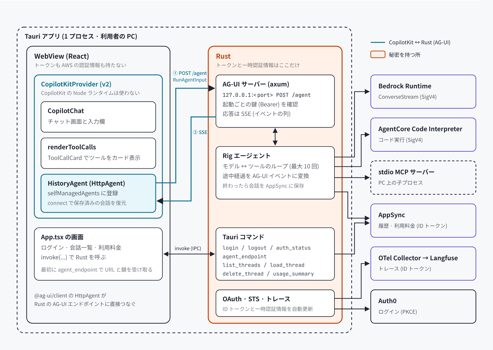
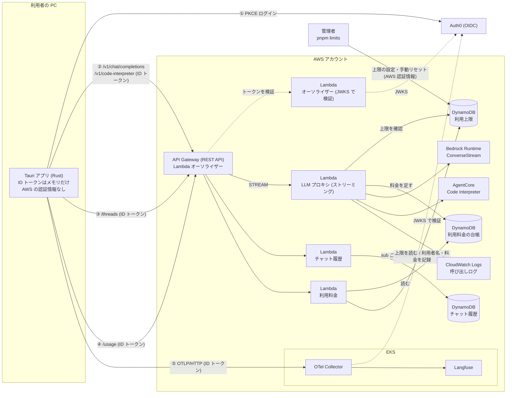

# agui-rig

React + CopilotKit のチャット UI を Tauri 2 のデスクトップアプリ (Windows / macOS / Linux) に載せ、エージェントを Rust の Rig で動かすアプリです。

- **モデル**: Amazon Bedrock。アプリは Bedrock を直接呼ばず、自前の **LLM プロキシ** (API Gateway → Lambda) を OpenAI 互換の Chat Completions で呼ぶ (Rig の OpenAI 互換プロバイダー)
- **認証**: Auth0 (OpenID Connect) でログインし、その **ID トークンだけ**でバックエンドを呼ぶ。**PC は AWS の認証情報を一切持たない**
- **利用上限**: プロキシがサーバー側で料金を記録し、上限に達した利用者のモデル呼び出しを断る。アプリを改造しても迂回できない
- **ツール**: Amazon Bedrock AgentCore Code Interpreter (プロキシ経由) と、PC 上で起動する stdio MCP サーバー
- **チャット履歴**: 同じ API Gateway (REST API + Lambda オーソライザー) → Lambda 経由で DynamoDB に保存。利用者は自分の会話だけを読み書きできる
- **画面**: shadcn/ui (Tailwind CSS v4) と CopilotKit v2 のチャット。OS の設定に合わせてライト / ダークを切り替える
- **画面との接続**: AG-UI プロトコル。フロントは `@ag-ui/client` の `HttpAgent` で Rust の AG-UI エンドポイントに直接つなぐ (CopilotKit の Node ランタイムは使わない)

## 目次

| 知りたいこと | 節 |
| --- | --- |
| 全体像 | [フォルダ構成](#フォルダ構成) ・ [アプリの構成](#アプリの構成) ・ [AWS 構成 (本番運用相当)](#aws-構成-本番運用相当) |
| 環境を作る | [Auth0 の設定](#auth0-の設定) ・ [開発用のログイン (Cognito)](#開発用のログイン-cognito) ・ [AWS 側の準備 (Terraform)](#aws-側の準備-terraform) ・ [開発者ごとの AWS 開発環境](#開発者ごとの-aws-開発環境) |
| 動かす | [動かし方](#動かし方) (模擬 / 本物の AWS / 自分の開発環境 / 本物の環境) |
| トレース・料金・上限 | [トレースと利用料金 (Langfuse)](#トレースと利用料金-langfuse) |
| 配る | [配布するとき (設定の渡し方)](#配布するとき-設定の渡し方) |
| その他 | [ファイル](#ファイル) ・ [補足](#補足) ・ [ライセンス](#ライセンス) |

## フォルダ構成

```
package.json      コマンドはすべてここ (ルート) から pnpm で実行する
pnpm-workspace.yaml   pnpm workspace (app/desktop、app/desktop/examples/time-mcp、app/backend)
app/
  desktop/        デスクトップアプリ (Tauri)
    src/          画面 (React + CopilotKit + shadcn/ui)
    src-tauri/    Rust (Rig のエージェント、ログイン、バックエンドの呼び出し)
    dev/          模擬サーバーと開発用の起動スクリプト
  backend/        API Gateway から呼ばれる Lambda (TypeScript): LLM プロキシ、オーソライザー、チャット履歴、利用料金
infra/
  terraform/      AWS のリソース (API Gateway、Lambda、DynamoDB、Cognito (開発用))
  dev-account/    開発用アカウントの初期設定 (開発者の権限セット、state のバケット、権限の上限)
  otel-collector.yaml   OpenTelemetry Collector の設定 (リファレンス。デプロイは Langfuse 側のリポジトリ)
docs/images/      README の図
```

## アプリの構成



画面の CopilotKit (`CopilotKitProvider` と `CopilotChat`) は、CopilotKit の Node ランタイムを使わず、
`selfManagedAgents` に登録した `HistoryAgent` (AG-UI の `HttpAgent` を拡張したもの) で Rust に直接つなぎます。

- ① 送信すると、`HistoryAgent` が会話と threadId を `RunAgentInput` にして `POST http://127.0.0.1:<port>/agent` に送る。URL と起動ごとの鍵は、最初に `invoke("agent_endpoint")` で受け取る
- ② Rust は Rig の実行の様子を AG-UI のイベント (`RUN_STARTED`、`TEXT_MESSAGE_*`、`TOOL_CALL_*`、`RUN_FINISHED`) にして SSE で返す。文章は `CopilotChat`、ツール呼び出しは `renderToolCalls` に登録した `ToolCallCard` が表示する
- 過去の会話を開くときは、`HistoryAgent.connect` が保存済みのメッセージを `MESSAGES_SNAPSHOT` として返して画面に復元する
- ログイン、会話一覧、利用料金は AG-UI ではなく、Tauri の `invoke` で Rust のコマンドを呼ぶ

<details>
<summary>テキスト版</summary>

```
┌───────────────────────── Tauri アプリ (1 プロセス) ─────────────────────────┐
│ WebView (React)                    Rust                                     │
│  CopilotChat ─ HttpAgent ─ POST /agent ─▶ axum (127.0.0.1) ─ AG-UI / SSE    │
│  ログイン画面 ─ invoke("login") ────────▶ OAuth (PKCE) ── ブラウザでログイン │
│                                           │ ID トークン (メモリだけ)         │
│                       Rig のツールループ ─┼─▶ LLM プロキシ /v1/chat/completions ─▶ (AWS) Bedrock
│                                           ├─▶ LLM プロキシ /v1/code-interpreter ─▶ (AWS) AgentCore
│                                           └─▶ stdio MCP サーバー (子プロセス)│
└─────────────────────────────────────────────────────────────────────────────┘
```

</details>

ログインからチャットまでの流れ:

1. 「ログイン」で OS の既定ブラウザが開き、Auth0 でログインする。リダイレクトは `http://127.0.0.1:<port>/callback` で受ける (RFC 8252、クライアントシークレットなし)。
2. 以後、Rust は ID トークンを `Authorization: Bearer` に付けてバックエンド (API Gateway) を呼ぶ。ID トークンはリフレッシュトークンで期限前に自動更新する。**トークンは Rust のメモリ上だけに置き、WebView には渡さない。AWS の認証情報はアプリのどこにも無い。**
3. チャットを送ると、Rig がモデル (LLM プロキシ) を呼び、モデルがツールを呼べば実行して結果を返す、をツールを呼ばなくなるまで繰り返す (最大 10 回)。その様子は AG-UI のイベント (`TEXT_MESSAGE_*`、`TOOL_CALL_START / ARGS / END / RESULT`) で画面に流れ、ツール呼び出しはカードで表示される。

### ツール

| ツール名 (モデルから見える名前) | 内容 |
| --- | --- |
| `code_interpreter_execute_code` | AgentCore Code Interpreter でコードを実行 (Python / JavaScript / TypeScript)。ログイン中はプロキシ経由 |
| `code_interpreter_execute_command` | 同じサンドボックスでシェルコマンドを実行 |
| `<サーバー名>__<ツール名>` | mcp.json に書いた stdio MCP サーバーのツール |

- Code Interpreter のセッションはチャットのスレッドごとに 1 つ作るので、同じスレッドでは変数やファイルが引き継がれる。ログアウトやアプリ終了で止める。
  プロキシ経由のときは、セッションを作るのも使うのもプロキシで、ほかの利用者のセッションは使えない (セッション名に利用者のハッシュを入れて確かめる)。
- MCP サーバーはアプリ起動時に子プロセスとして起動し、終了時に止める。**AWS の認証情報などを渡さないよう、環境変数は `PATH` など最小限だけ引き継ぐ** (必要なものは mcp.json の `env` に書く)。Windows では `npx` などのバッチファイルも動くよう `cmd /C` 経由で、コンソールウィンドウを出さずに起動する。

## AWS 構成 (本番運用相当)

このリポジトリの AWS 構成は、検証用の簡易版ではなく**本番運用相当の構成**です。
各 PC のアプリ (Rust) は、ID トークンで **1 つの API Gateway** を呼ぶだけです。Bedrock と AgentCore Code Interpreter を呼ぶのはサーバー側の LLM プロキシ (Lambda) だけで、
PC には AWS の認証情報も Langfuse のキーも置きません。画面 (React) はクラウドに直接つながりません。


図の元データは [docs/images/aws-architecture.drawio](docs/images/aws-architecture.drawio) です (draw.io で開いて直せます)。PNG はアイコンを簡略化して書き出したものなので、AWS の公式アイコンで見るときは draw.io で開いてください。

本番運用相当にしている点:

- **PC に AWS の認証情報なし**: アプリが持つのはログインの ID トークン (1 時間、自動更新) だけ。IAM ロールも STS も使わないので、PC から AWS の API は呼べない
- **迂回できない利用上限**: LLM プロキシが呼ぶ前に台帳で上限を確かめ (達していれば 429)、Bedrock が返したトークン数 × 単価で料金を DynamoDB に足す。アプリを改造しても上限を越えて呼べない
- **呼べるモデルと出力の制限**: プロキシは `model_prices` に載っているモデルだけを呼び、出力トークンを `max_output_tokens` で切り詰める
- **最小権限**: Bedrock と AgentCore の権限はプロキシの Lambda のロールだけが持つ。履歴・利用料金の Lambda はそれぞれのテーブルだけ
- **利用者の分離**: 全ルートで同じ Lambda オーソライザーが ID トークンを検証し、検証済みの `sub` だけで履歴・料金・Code Interpreter のセッションを分ける
- **監査とコスト**: 呼び出しごとに利用者・モデル・トークン数・料金・所要時間をプロキシが CloudWatch Logs に 1 行の JSON で出す (本文は出さない)。請求額の正は Cost Explorer、会話別の内訳は Langfuse
- **可観測性**: トレースは今まで通り、アプリから ID トークンを検証する OTel Collector 経由でセルフホストの Langfuse に送る (EKS 上の Langfuse と Collector のデプロイは別リポジトリで管理)
- **IaC**: AWS のリソースは `infra/terraform/` の Terraform で作る (下の「AWS 側の準備」)

<details>
<summary>同じ図の Mermaid 版 (テキストで直すとき用)</summary>



</details>

| 通信 | 認証 | 用途 |
| --- | --- | --- |
| ① アプリ → Auth0 | Authorization Code + PKCE (シークレットなし) | ログイン、ID トークンとリフレッシュトークンの取得 |
| ② アプリ → API Gateway → LLM プロキシ (Lambda) → Bedrock / AgentCore | ID トークン (Lambda オーソライザー)。プロキシ → AWS は Lambda のロール | モデルの呼び出し (`POST /v1/chat/completions`、OpenAI 互換、SSE でストリーミング) と Code Interpreter (`POST /v1/code-interpreter/invoke`、`/stop`)。モデルの制限・利用上限・料金の記録・ログ |
| ③ アプリ → API Gateway → Lambda → DynamoDB | ID トークン (同上) | チャット履歴 (`/threads`)。Lambda が ID トークンの `sub` だけで利用者を分ける |
| ④ アプリ → API Gateway → Lambda → DynamoDB | ID トークン (同上) | 自分の利用料金 (`/usage`、今日・今月) と利用上限の状態。プロキシが書いた台帳から読む。呼ばれるたびに `sub`・利用者名・最新の料金を上限テーブルに記録する |
| ⑤ アプリ → OTel Collector → Langfuse | ID トークン (Collector の oidc 認証)。Collector → Langfuse は Langfuse のキー | トレース、トークン数、料金の内訳。利用者 ID は Collector が検証済みの `sub` で上書きする |
| 管理者 → DynamoDB (利用上限) | 管理者の AWS 認証情報 | 利用者ごとの月の上限と手動リセット (`pnpm limits`)。利用者からは変えられない |

番号は上の図の番号と同じです。

- PC 上の stdio MCP サーバーは AWS を通りません。
- ②〜④ は 1 つの REST API にまとめ、オーソライザーも共用します。プロキシのルートだけ、API Gateway のレスポンスストリーミング (`response_transfer_mode = "STREAM"`) で
  Lambda の応答をそのまま流します (最大 15 分、無通信 5 分まで)。HTTP API は応答をまとめて返すので使っていません。
- オーソライザー (`app/backend/src/authorizer.ts`) は ID トークンの署名 (issuer の JWKS)・`iss`・`aud` (Client ID)・期限を確かめ、
  Cognito の `token_use` が `id` 以外 (アクセストークン) なら断ります。Auth0 のアクセストークンは `aud` が API の Identifier なので通りません。
  結果はトークンごとに `authorizer_cache_ttl` 秒 (既定 300) 使い回します。
- プロキシは OpenAI 互換の Chat Completions を話すので、アプリは Rig の OpenAI 互換プロバイダーに base URL (`<CHAT_API_URL>/v1`) と ID トークンを渡すだけです。
  プロキシの中で Bedrock の Converse / ConverseStream に変換します (ツール呼び出し、プロンプトキャッシュのトークン数も含む)。
- トレースは今まで通りアプリから送ります。Langfuse のキーは Collector だけが持ち、PC には置きません。

## Auth0 の設定

ログインには Auth0 を使います。Auth0 側とこのアプリ側で、次のように合わせます。

| 場所 | 設定 |
| --- | --- |
| Auth0 の Application | 種類は **Native**。Grant Types は **Authorization Code** と **Refresh Token**。Refresh Token Rotation を有効にする |
| Auth0 の Allowed Callback URLs | `http://127.0.0.1:53682/callback` (ポートは下の `OAUTH_REDIRECT_PORT` と同じ値) |
| アプリ | `OAUTH_ISSUER=https://<テナント>.auth0.com/` (カスタムドメインならその URL)、`OAUTH_CLIENT_ID=<Client ID>`、`OAUTH_REDIRECT_PORT=53682` |

- Auth0 はコールバック URL をポートまで完全一致で確かめるので、`OAUTH_REDIRECT_PORT` の固定が**必須**です (未設定だと空いているポートを使うため、Auth0 に断られます)。
  そのポートが PC で使われていると、ログインできません。ほかと重なりにくい番号を選んでください
- リフレッシュトークンは `offline_access` スコープで受け取ります (既定のスコープに入っています)
- ID トークンの `iss` は `https://<テナント>.auth0.com/` で、**末尾に `/` が付きます**。issuer を書く所 (下の 2 か所) は、どちらもこの末尾の `/` まで合わせてください
  - API Gateway のオーソライザーが検証する issuer (Terraform の `oidc_issuer`)
  - Collector の `issuer_url` (`infra/otel-collector.yaml`)
- ID トークンの `aud` は Client ID です。上の 2 か所の audience / クライアント ID には Client ID を入れます
- 利用者 ID の `sub` は `auth0|...` や `google-oauth2|...` の形です。DynamoDB と Langfuse にはそのまま入ります

## 開発用のログイン (Cognito)

Auth0 を本番でしか使えない場合、開発環境では Amazon Cognito のユーザープールで同じ動きをさせられます。
Cognito も OpenID Connect の ID トークンを出すので、API Gateway のオーソライザーと Collector はそのまま動きます。

| 項目 | 本番 (Auth0) | 開発 (Cognito) |
| --- | --- | --- |
| `OAUTH_ISSUER` | `https://<テナント>.auth0.com/` (末尾 `/` あり) | `https://cognito-idp.<リージョン>.amazonaws.com/<プール ID>` (末尾 `/` なし) |
| `OAUTH_CLIENT_ID` (ID トークンの `aud`) | Auth0 の Client ID | Cognito のアプリクライアント ID |
| リダイレクト URI | `http://127.0.0.1:53682/callback` | `http://localhost:53682/callback` (Cognito は http なら `localhost` しか許さない) |
| リフレッシュトークン | `offline_access` スコープで受け取る | スコープ指定なしで出る (`offline_access` は受け付けない) |
| 利用者 ID (`sub`) | `auth0\|...` など | UUID |

アプリ側は、issuer が Cognito なら自動で `localhost` にリダイレクトし、`offline_access` も外すので、`OAUTH_ISSUER` と `OAUTH_CLIENT_ID` を変えるだけです
(明示するなら `OAUTH_REDIRECT_HOST=localhost`)。`localhost` のときは 127.0.0.1 と ::1 の両方で受けます。

Terraform で作る場合は、本番とは別の state (例: `terraform workspace new dev`) で `create_cognito = true` にします (`oidc_issuer` / `oidc_client_id` は空にする)。
開発者が各自の環境を持つなら、下の [開発者ごとの AWS 開発環境](#開発者ごとの-aws-開発環境) のコマンドがこれを 1 人ずつ作ります。

```sh
cd infra/terraform
terraform workspace new dev
terraform apply -var create_cognito=true -var name=agui-rig-dev -var table_name=agui-rig-dev-chat-history
terraform output   # oauth_issuer → OAUTH_ISSUER、oauth_client_id → OAUTH_CLIENT_ID、chat_api_url → CHAT_API_URL

# 利用者は管理者が作る (自分でサインアップはできない設定)。仮パスワードは初回ログインで変更を求められる
aws cognito-idp admin-create-user --user-pool-id "$(terraform output -raw cognito_user_pool_id)" \
  --username dev@example.com --user-attributes Name=email,Value=dev@example.com Name=email_verified,Value=true
```

作られるもの: ユーザープール (メールでログイン、管理者だけが利用者を作れる)、ログイン画面のドメイン、
デスクトップ用のパブリッククライアント (シークレットなし、Authorization Code + PKCE、ID トークン 1 時間、リフレッシュトークン 30 日)。
アプリの設定は `app/desktop/config/dev.example.json` を参考に、開発用のビルドに埋め込めます。

## AWS 側の準備 (Terraform)

AWS のリソースは `infra/terraform/` の Terraform で作ります。作るもの:

| リソース | 内容 |
| --- | --- |
| API Gateway (REST API) | ステージ `api`。全ルート共通の Lambda オーソライザー (TOKEN 型)。`/v1/chat/completions`・`/v1/code-interpreter/invoke`・`/v1/code-interpreter/stop` (ストリーミング)、`/threads`・`/threads/{id}`・`/usage` (通常)。スロットリング付き |
| オーソライザーの Lambda | `app/backend/src/authorizer.ts`。ID トークンを issuer の JWKS で検証し、`sub` と利用者名を各 Lambda に渡す |
| LLM プロキシの Lambda | `app/backend/src/proxy.ts`。Bedrock の呼び出しと AgentCore Code Interpreter、台帳と上限テーブルの読み書きだけの権限。レスポンスストリーミングで呼ばれる |
| チャット履歴の Lambda | `app/backend/src/history.ts`。DynamoDB の読み書きだけの権限 |
| 利用料金の Lambda | `app/backend/src/usage.ts`。台帳を読み、上限テーブルに利用状況を書く |
| DynamoDB テーブル (チャット履歴) | `pk` = 利用者の `sub`、`sk` = 会話 ID |
| DynamoDB テーブル (利用料金の台帳) | `pk` = `sub`、`sk` = `M#<年月>` / `D#<年月日>`。プロキシが料金とトークン数を足す。日の項目は 100 日で TTL で消える |
| DynamoDB テーブル (利用上限) | `pk` = `sub`。上限と手動リセットは管理者だけが書き、利用者名と最新の料金は利用料金の Lambda が書く |
| Cognito (開発用、任意) | `create_cognito = true` のときだけ。上の「開発用のログイン」 |

アプリ用の IAM ロールや IAM の OIDC プロバイダーは作りません (アプリは AWS を直接呼ばないため)。

```sh
cd infra/terraform
cp terraform.tfvars.example terraform.tfvars   # oidc_issuer、oidc_client_id、model_prices などを入れる
# Lambda (app/backend の TypeScript) を先にビルドする (esbuild で dist/ に作る)
(cd ../.. && pnpm install && pnpm backend:build)
terraform init
terraform plan
terraform apply
terraform output   # chat_api_url (API Gateway の URL) → CHAT_API_URL、allowed_models → BEDROCK_MODEL_ID に使えるモデル
```

- AWS プロバイダーは 6.26 以上が要ります (REST API のレスポンスストリーミング `response_transfer_mode`)
- state の置き場所 (S3 など) は、チームの方針に合わせて `backend` を足してください (今はローカル)
- `oidc_issuer` は ID トークンの `iss` と**完全に一致**させてください (Auth0 は末尾に `/` が付きます)
- **呼べるモデルと単価は `model_prices`** で決めます (100 万トークンあたりの USD)。載っていないモデルは 400 で断ります。
  単価はリージョンや推論プロファイルで変わるので、Bedrock の料金ページで確かめて入れてください。IAM でも絞るなら `bedrock_model_arns`
- 1 回の出力の上限は `max_output_tokens` (既定 16384)。全利用者の同時実行を抑えるなら `proxy_reserved_concurrency`
- プロキシが使う Code Interpreter は `code_interpreter_id` (既定は AWS マネージドの `aws.codeinterpreter.v1`)。アプリからは変えられません
- テーブルは会話 1 件を 1 項目にし、メッセージは gzip + base64 で 1 つの属性に入れます。
  上限 (400KB) を超えそうなときは、長いツールの出力を切り詰め、それでも大きければ古いメッセージから落とします
- 一覧は 1 人あたり新しい順に最大 200 件です
- 各 Lambda はオーソライザーが検証した `sub` 以外の利用者を指定できないので、他人の会話・料金・セッションには届きません
- API の料金はリクエスト数で決まります (REST API は 100 万件あたり約 3.5〜4.25 USD。リージョンで違う)。会話 1 回で、モデル呼び出しがツールの回数 + 1 回、保存と一覧の読み直しが数回起きます
- 全リソースに `Project`、`Environment` (`environment`、既定 `prod`)、`Owner` (`owner` を指定したとき) のタグが付きます

## 開発者ごとの AWS 開発環境

開発者 1 人ずつに、自分専用のバックエンド (Cognito・API Gateway・Lambda・DynamoDB) を AWS に作り、
手元のアプリ (`tauri dev`) をそこへ向けます。模擬ではなく本物のログイン → LLM プロキシ (Bedrock / Code Interpreter) → 履歴・利用料金の API の流れを、
他の人の環境に影響を与えずに試せます。

自分の設定はルートの `.env.cloud` に env 形式で持ちます (git には入りません)。

```sh
cp .env.cloud.example .env.cloud   # DEV_ENV_USER、DEV_ENV_EMAIL、AWS_PROFILE、AWS_REGION を自分の値に
aws sso login --profile my-dev     # など。IAM・Cognito・Lambda などを作れる権限が要る
pnpm dev-env up                    # 作る (terraform apply の確認が出る)。接続先が .env.cloud に書き足される
pnpm dev:cloud                     # .env.cloud の値でアプリを起動し、DEV_ENV_EMAIL のメールでログイン
pnpm dev-env down                  # 丸ごと消す。書き足した接続先も消える (自分で書いた値は残る)
```

`up` の後の `.env.cloud` はこうなります:

```sh
DEV_ENV_USER=alice
DEV_ENV_EMAIL=alice@example.com
AWS_PROFILE=my-dev
AWS_REGION=ap-northeast-1

# ---- pnpm dev-env up が書く接続先 (手で変えない。down で消える) ----
OAUTH_ISSUER=https://cognito-idp.ap-northeast-1.amazonaws.com/ap-northeast-1_XXXXXXXXX
OAUTH_CLIENT_ID=xxxxxxxxxxxxxxxxxxxxxxxxxx
OAUTH_REDIRECT_PORT=53682
CHAT_API_URL=https://xxxxxxxxxx.execute-api.ap-northeast-1.amazonaws.com/api
```

| コマンド | 内容 |
| --- | --- |
| `pnpm dev-env up` | バックエンドの Lambda をビルドし、Terraform workspace `dev-<名前>` で `infra/terraform` を apply。自分のメールで Cognito の利用者を作り (仮パスワードがメールで届く)、接続先を `.env.cloud` に書き足す |
| `pnpm dev:cloud` | `.env.cloud` の値 (`OAUTH_ISSUER`、`OAUTH_CLIENT_ID`、`CHAT_API_URL`、あれば `BEDROCK_MODEL_ID`) で `tauri dev` を起動。アプリには `AWS_PROFILE` などの AWS の認証情報を渡さない |
| `pnpm dev-env status` | 自分の環境の接続先を表示し、`.env.cloud` に書き直す |
| `pnpm dev-env down` | `terraform destroy` の後、workspace と `.env.cloud` の接続先を消す |
| `pnpm dev-env list` | この state にある開発者ごとの環境 (`dev-*` の workspace) |

- **設定の優先順**: コマンドの引数 (`--user`、`--email`、`--region`) > シェルの環境変数 > `.env.cloud`。
  `up` のときに `.env.cloud` に名前・メール・リージョンが無ければ、使った値を書いておきます
- **名前**: `--user` > `DEV_ENV_USER` > OS のユーザ名 (英小文字・数字・ハイフン、20 文字まで)。リソース名の接頭辞は `agui-rig-dev-<名前>` です。
  メールは `--email` > `DEV_ENV_EMAIL` > `git config user.email`、リージョンは `--region` > `AWS_REGION` > `ap-northeast-1`
- **分離**: ユーザープール・API・Lambda・テーブルはすべて人ごとに別で、Terraform の state も workspace で分かれます
- **料金**: どれも従量課金のサーバーレスなので、使っていない間はほぼかかりません (Cognito は月 1 万 MAU まで無料、
  DynamoDB はオンデマンドで PITR を切る、API Gateway と Lambda はリクエスト数)。実際にかかるのは Bedrock と Code Interpreter を呼んだ分です
- **利用料金と上限**: 本番と同じく台帳と上限テーブルを作るので、画面に料金が出て、`pnpm limits` で上限も試せます。トレースは既定では送りません
- **消し忘れ**: 全リソースに `Environment=dev`、`Owner=<名前>` のタグが付くので、
  `aws resourcegroupstaggingapi get-resources --tag-filters Key=Environment,Values=dev` などで探せます
- `--` の後ろは Terraform にそのまま渡ります (例: `pnpm dev-env up -- -auto-approve -var 'bedrock_model_arns=["..."]'`)
- state は、`.env.cloud` に `DEV_ENV_STATE_BUCKET` があればチームの S3 バケットに、無ければ各自の PC
  (`infra/terraform/terraform.tfstate.d/dev-<名前>/`) に置きます。S3 なら `list` で全員の環境が見えます

### 開発用アカウントの準備 (管理者が一度だけ)

開発者の環境はすべて、本番とは別の開発用 AWS アカウント 1 つに作ります (AWS Organizations で本番と分ける)。
開発者は IAM Identity Center (SSO) でそのアカウントに入り、長期のアクセスキーは使いません。
その準備を `infra/dev-account/` の Terraform で作ります:

| リソース | 場所 | 内容 |
| --- | --- | --- |
| state のバケット | 開発用アカウント | 開発者ごとの state (`agui-rig-dev/<workspace>/...`)。バージョニング、暗号化、公開ブロック、TLS 必須。古い版は 90 日で消す。ロックは S3 のロックファイル |
| 権限の上限 (`agui-rig-dev-boundary`) | 開発用アカウント | 開発者が作る IAM ロール (Lambda 用) に必ず付ける permissions boundary。Bedrock と Code Interpreter、`agui-rig-dev-*` のテーブル、ログだけ |
| 権限セット (`AguiRigDeveloper`) | Identity Center | 開発者用。下の範囲だけ。`developer_group_name` のグループに、開発用アカウントで割り当てる |

権限セットでできること:

- `agui-rig-dev-*` の IAM ロールの作成・変更・削除。**作れるのは権限の上限を付けたロールだけ**で、上限は外せない。付けられる AWS 管理ポリシーは Lambda の実行用だけ
- Cognito、API Gateway (REST API)、`agui-rig-dev-*` の Lambda と DynamoDB
- state のバケットの読み書き、`agui-rig-dev-*` の Lambda のログの閲覧、タグでの検索
- 自分の認証での Bedrock と Code Interpreter (`pnpm dev:aws` 用。`allow_bedrock = false` で外せる)

```sh
cd infra/dev-account
cp terraform.tfvars.example terraform.tfvars   # 2 つのアカウントのプロファイル、開発者のグループ名
terraform init
terraform apply
terraform output -raw env_cloud   # → チームの .env.cloud.example に書いて共有する
```

- Terraform 1.10 以上が要ります (S3 のロックファイル)。`pnpm dev-env` で S3 の state を使うときも同じです
- 権限セットは IAM Identity Center を管理するアカウント (管理アカウントか委任管理者) に作るので、`identity_center_profile` はそのアカウントの管理者にします。
  Identity Center を使わないなら `create_permission_set = false` で、バケットと権限の上限だけ作れます
- state のバケットは `prevent_destroy` で消せないようにしてあります

出力の `env_cloud` は次の 3 行です。開発者は自分の `.env.cloud` にこれを入れ、`AWS_PROFILE` には `aws configure sso` で作った
`AguiRigDeveloper` のプロファイルを書きます:

```sh
DEV_ENV_STATE_BUCKET=agui-rig-dev-tfstate-123456789012
DEV_ENV_STATE_REGION=ap-northeast-1
DEV_ENV_PERMISSIONS_BOUNDARY=arn:aws:iam::123456789012:policy/agui-rig-dev-boundary
```

`pnpm dev-env` は `DEV_ENV_STATE_BUCKET` があると、`infra/terraform` の state 設定 (本番) は変えずに、実行中だけ
S3 の backend の上書きファイル (`dev_env_backend_override.tf`) を置き、`.terraform-dev/` を使います。
`DEV_ENV_PERMISSIONS_BOUNDARY` は Terraform の `permissions_boundary_arn` として全部の IAM ロールに付きます。

## 動かし方

必要なもの: Node.js 20 以上、pnpm 10 (`corepack enable` で `package.json` の `packageManager` の版が使われます)、Rust 1.97.1 以上、[Tauri の前提パッケージ](https://v2.tauri.app/start/prerequisites/) (Windows は WebView2 と MSVC ビルドツール)。

コマンドはすべてリポジトリのルートの `package.json` にまとめてあり、ルートで `pnpm <コマンド>` として実行します。

| コマンド | 内容 |
| --- | --- |
| `pnpm install` | 全 workspace (アプリ、例の MCP サーバー、バックエンド) の依存を入れる |
| `pnpm dev:mock` | 全部模擬で起動 (下の「まず試す」) |
| `pnpm dev:aws` | ログインを省略して本物の AWS で起動 |
| `pnpm dev-env up` / `down` / `status` / `list` | 自分専用の AWS 開発環境を作る・消す ([開発者ごとの AWS 開発環境](#開発者ごとの-aws-開発環境)) |
| `pnpm dev:cloud` | 自分専用の AWS 開発環境に向けて起動 |
| `pnpm tauri <引数>` | `app/desktop` で Tauri CLI を実行 (`pnpm tauri dev`、`pnpm tauri build` など) |
| `pnpm mock-server` | 模擬サーバーだけを起動 |
| `pnpm e2e` / `pnpm e2e:aws` | E2E テスト (模擬環境 / 本物の AWS)。[E2E テスト](#e2e-テスト-模擬環境) |
| `pnpm smoke:aws` | 本物の AWS への疎通確認。[疎通確認](#本物の-aws-への疎通確認) |
| `pnpm desktop:build` | 画面 (Vite) のビルド |
| `pnpm backend:build` / `backend:test` / `backend:typecheck` | バックエンドの Lambda のビルド・テスト・型チェック |
| `pnpm limits <サブコマンド>` | 利用上限の管理 ([利用上限](#トレースと利用料金-langfuse)) |
| `pnpm check` | 型チェック・テスト・ビルドをまとめて (CI と同じ) |

引数はそのまま渡せます (`pnpm dev-env up --user alice`)。`--` の後ろは、`dev-env` では Terraform への引数になります。

### まず試す (全部模擬)

```sh
pnpm install
pnpm dev:mock
```

以下、コマンドはどれもリポジトリのルートで実行します (`pnpm install` は全 workspace の依存をまとめて入れます)。

`dev/mock-server.mjs` の模擬サーバー (`http://127.0.0.1:9100`) を立てて、Auth0、API Gateway (履歴・利用料金・LLM プロキシ・Code Interpreter の中継)、
OTel Collector をすべてそこに向けた状態でアプリを開発ビルドで起動します。AWS アカウントも費用も要りません。

- 「ログイン」を押すとブラウザが開き、すぐに「模擬 太郎」でログインした状態になります
- 何か送ると、模擬の LLM プロキシが OpenAI 互換の SSE で、決まった筋書きの MCP の時刻ツール → Code Interpreter → 回答 の順に応答します
  (画面やツール表示の開発向け。回答の中身は意味のあるものではありません)
- 模擬の Code Interpreter はコードを実行しません (受け取ったことだけ返します)
- 模擬のバックエンドがチャット履歴をメモリに持つので、左の一覧から過去の会話を開けます (模擬サーバーを止めると消えます)
- 模擬サーバーが受けたリクエスト (プロキシへのモデル呼び出しと利用者、Code Interpreter の中継、Collector へのトレース送信など) はターミナルに `[mock]` で出ます
- 例の MCP サーバー (`app/desktop/examples/time-mcp`) の依存も `pnpm install` で入ります

### ログインを省略して本物の AWS で試す

```sh
aws sso login --profile my-dev      # など、ローカルの AWS 認証を用意する
AWS_PROFILE=my-dev AWS_REGION=ap-northeast-1 pnpm dev:aws
```

Auth0 もプロキシも使わず、開発者自身の AWS 認証 (`AWS_PROFILE`、SSO、環境変数のキーなど) で本物の Bedrock と
AgentCore Code Interpreter を**直接**呼びます。そのプロファイルには Bedrock と AgentCore Code Interpreter の権限が必要です。
`.env` に `AWS_PROFILE` などを書いておいても使われます。履歴と利用料金は使いません (ログインしないため)。
開発ビルド専用で、リリースビルドには AWS を直接呼ぶ経路はありません。

### 自分専用の AWS 開発環境で試す

```sh
pnpm dev-env up      # 初回だけ。上の「開発者ごとの AWS 開発環境」
pnpm dev:cloud
```

`pnpm dev-env up` で作った自分の環境 (Cognito でログイン → 自分の API Gateway の LLM プロキシ・履歴・利用料金) に向けて起動します。

`dev:mock`、`dev:aws`、`dev:cloud` は開発ビルド専用です。リリースビルドでは、

- ログインの省略 (`DEV_SKIP_LOGIN`、`OAUTH_ISSUER` 未設定) はできず、ログイン画面に設定エラーを出します
- `OAUTH_ISSUER` と `CHAT_API_URL` は `https://` 必須なので、模擬サーバー (`http://127.0.0.1`) には向けられません
- モデルと Code Interpreter は必ずプロキシ経由です (`LLM_MODEL` や AWS の直接呼び出しは無視します)

### 本物の環境で動かす

```sh
pnpm install
cp app/desktop/.env.example app/desktop/.env            # OAuth / バックエンドの URL / モデルの設定
cp app/desktop/mcp.example.json app/desktop/mcp.json    # 使う MCP サーバー (例は examples/time-mcp)
MCP_CONFIG=./mcp.json pnpm tauri dev                    # ./mcp.json は app/desktop からの相対
```

設定は `.env.example` を参照してください。主なもの:

| 変数 | 内容 |
| --- | --- |
| `OAUTH_ISSUER` / `OAUTH_CLIENT_ID` | ログインの IdP (本番は Auth0、開発は Cognito も可)。開発ビルドでは、未設定ならログインなしの開発モード。リリースビルドでは `https://` で必須 |
| `OAUTH_REDIRECT_PORT` / `OAUTH_REDIRECT_HOST` | リダイレクトを受けるポートとホスト (`127.0.0.1` か `localhost`)。ホストは未設定なら、Cognito は `localhost`、それ以外は `127.0.0.1` |
| `DEV_SKIP_LOGIN` | `1` でログインを省略 (開発ビルドだけ。`pnpm dev:aws` が設定する) |
| `CHAT_API_URL` | バックエンド (API Gateway) の URL。Terraform の出力 `chat_api_url` (`https://…/api`)。ログインして使うときは必須で、LLM プロキシ・Code Interpreter・履歴・利用料金をすべてここ経由で呼ぶ |
| `BEDROCK_MODEL_ID` | モデル (既定 `global.anthropic.claude-sonnet-5-5`)。ログイン中はプロキシの許可リスト (Terraform の `model_prices`) に載っているもの |
| `CODE_INTERPRETER_ID` | `off` で Code Interpreter を使わない。ログイン中はどれを使うかはプロキシ側で決まる。開発モード (`dev:aws`) では直接呼ぶ ID (既定 `aws.codeinterpreter.v1`) |
| `AWS_REGION` | 開発モード (`dev:aws`) で直接呼ぶときのリージョン。ログイン中は使わない |
| `MCP_CONFIG` | mcp.json の場所。未設定ならアプリの設定フォルダの `mcp.json` |
| `LANGFUSE_HOST` / `LANGFUSE_PUBLIC_KEY` / `LANGFUSE_SECRET_KEY` | トレースを Langfuse に送る ([トレースと利用料金](#トレースと利用料金-langfuse)) |
| `OTEL_EXPORTER_OTLP_ENDPOINT` / `OTEL_EXPORTER_OTLP_HEADERS` | Langfuse のキーの代わりに、任意の OTLP/HTTP 受け口 (Collector など) に送る |
| `TELEMETRY_AUTH` | `id_token` で、OTLP の送信にログイン中の ID トークンを付ける (Collector で検証する。[本番は Collector 経由](#本番は-collector-経由でid-トークンで認証して送る)) |
| `TELEMETRY_RECORD_CONTENT` | `true` でプロンプト・回答・ツールの入出力もトレースに含める (既定は含めない。利用者 ID の `sub` は常に送る) |
| `RUST_LOG` | ログの詳しさ (既定 `info`) |

### Anthropic API で動作確認する

Bedrock の準備前に本物のモデルで試したい場合は、`.env` に次を書きます (`.env` はコミットされません)。

```sh
LLM_MODEL=anthropic/claude-sonnet-5-5
ANTHROPIC_API_KEY=...
```

開発ビルドで OAuth を設定していないときだけ使えます (ログイン中は必ずプロキシ経由)。Code Interpreter は無効になります (AWS の認証が無いため)。AWS の認証があるなら `CODE_INTERPRETER_ID=aws.codeinterpreter.v1` で有効にできます。

### 模擬サーバーと AWS のエンドポイント

`pnpm dev:mock` の模擬サーバーは単体でも起動できます (`pnpm mock-server`)。
`MOCK_MONTHLY_LIMIT_USD=1.24 pnpm dev:mock` のように上限を渡すと、数回のやり取りで利用上限に達する様子を試せます (模擬のプロキシも本物と同じく 429 で断ります)。
開発モード (`dev:aws`) で直接呼ぶ AWS のエンドポイントは、AWS SDK 標準の環境変数 `AWS_ENDPOINT_URL_BEDROCK_RUNTIME` / `AWS_ENDPOINT_URL_BEDROCK_AGENTCORE` で差し替えられます。

### E2E テスト (模擬環境)

`app/desktop/e2e/` に、開発ビルドのアプリを [tauri-driver](https://v2.tauri.app/develop/tests/webdriver/) (WebDriver) で操作する E2E テストがあります。
`pnpm dev:mock` と同じ模擬サーバーに向けて、次の流れを確かめます。

1. ログイン画面から模擬の Auth0 でログインする (ブラウザの代わりに、認可 URL のリダイレクトをたどるだけの `xdg-open` を使う)
2. メッセージを送り、MCP の時刻ツール → Code Interpreter → 回答 まで表示される
3. 会話が履歴に保存され、「新しい会話」から戻って開き直せる
4. 利用料金がヘッダーに出て、上限に近づくと警告、達すると送れない (上限は模擬サーバーの `PUT /__mock/config` で切り替える)

```sh
# Linux (Ubuntu) の例。Tauri の前提パッケージに加えて WebKitWebDriver と Xvfb が要る
# (WebKitWebDriver のパッケージは Ubuntu 24.04 までは webkit2gtk-driver、新しい版は webkitgtk-webdriver)
sudo apt-get install -y webkit2gtk-driver xvfb ffmpeg fonts-noto-cjk
cargo install tauri-driver --locked

pnpm install
pnpm tauri build --debug --no-bundle
xvfb-run -a -s "-screen 0 1280x800x24" pnpm e2e
```

スクリーンショットと録画 (ffmpeg があるとき) は `app/desktop/e2e/artifacts/` に出ます。
CI (`.github/workflows/e2e.yml`) でも Ubuntu で動かし、成果物 `e2e-artifacts` に残します。
macOS には WebDriver が無いため、tauri-driver の E2E は Linux と Windows だけで動きます。

### 本物の AWS への疎通確認

`pnpm smoke:aws` で、アプリが使う AWS のサービスを 1 つずつ最小の呼び出しで確かめます。
Bedrock と AgentCore の直接呼び出しは AWS SDK 標準の認証 (`AWS_PROFILE`、SSO など) で、`pnpm dev:aws` と同じです。`app/desktop/.env` と、ルートの `.env.cloud` も読みます
(`pnpm dev-env up` で自分の開発環境を作っていれば、`AWS_PROFILE` と `CHAT_API_URL` はそこから入ります)。

```sh
AWS_PROFILE=my-dev AWS_REGION=ap-northeast-1 pnpm smoke:aws
# API Gateway の認証付きの呼び出し (履歴・利用料金・LLM プロキシ) まで確かめるなら、ログインで得た ID トークンを ID_TOKEN で渡す
```

| 確認 | 内容 |
| --- | --- |
| STS | 認証情報が有効か (GetCallerIdentity) |
| Bedrock | `BEDROCK_MODEL_ID` のモデルを直接、最大 16 トークンで呼ぶ (わずかに費用がかかる) |
| AgentCore | Code Interpreter のセッションを開始し、`print(1 + 1)` を実行して終了する (`CODE_INTERPRETER_ID=off` で省略) |
| API Gateway | `CHAT_API_URL` があれば、トークンなしで 401 になること。`ID_TOKEN` もあれば `/threads` と `/usage` が 200 になること |
| LLM プロキシ | `ID_TOKEN` があれば、`/v1/chat/completions` で 16 トークンだけ呼べることと、`/v1/code-interpreter/invoke` で `print(1 + 1)` が `2` を返すこと |

画面まで含めて確かめるなら、Linux では `pnpm e2e:aws` で、`dev:aws` と同じ設定 (ログインなし) のアプリに
「Code Interpreter で計算して」と送り、本物のモデルの回答を待つ E2E も動かせます (費用がかかります)。

## トレースと利用料金 (Langfuse)

利用料金と利用上限の**正は LLM プロキシの台帳** (DynamoDB) です。Langfuse は、トレースと会話別・呼び出し別の内訳を見るために今まで通り使います。

Rig はモデル呼び出しごとに OpenTelemetry の GenAI 規約に沿ったスパン (モデル名、トークン数など) を出します。
アプリはそれを OTLP/HTTP で Langfuse の `/api/public/otel/v1/traces` に送ります。

Langfuse での見え方:

- チャット 1 回 = トレース 1 本。名前は `chat`、セッション = AG-UI のスレッド ID
- その下に、モデル呼び出し (`chat`、Generation として表示) とツール呼び出し (`execute_tool <ツール名>`) が順に並ぶ
- 失敗した実行とツールは ERROR レベルになる

本文 (プロンプト、回答、ツールの入出力) は `TELEMETRY_RECORD_CONTENT=true` のときだけ送ります。
利用者 ID には ID トークンの `sub` (不透明な ID) を常に送ります。AWS の認証情報は送りません。
ID トークンは、`TELEMETRY_AUTH=id_token` のときに Collector への認証ヘッダーとしてだけ使います (トレースの中身には入れません)。

### 料金の計測

モデル呼び出しのスパンには、トークン数を重ならない 4 つの区分に分けて載せています
(`langfuse.observation.usage_details`)。Langfuse はこれにモデル定義の単価を掛けて、
呼び出し・トレース・利用者・セッションごとの料金を出します。

| キー | 中身 |
| --- | --- |
| `input` | キャッシュを使わなかった入力トークン |
| `output` | 出力トークン |
| `cache_read_input_tokens` | キャッシュから読んだ入力トークン |
| `cache_creation_input_tokens` | キャッシュに書いた入力トークン |

Bedrock のモデル ID (`global.anthropic.claude-sonnet-5-5` など) は Langfuse 組み込みの単価表に
一致しないことがあるので、使うモデルごとにモデル定義を 1 件追加します。

1. Langfuse の **Project Settings → Models** で **Add model definition** を押す
   (トレース画面の Generation に出ているモデル名のバッジからも作れます)
2. **Model name**: 分かりやすい名前 (例 `bedrock-claude-sonnet-5-5`)
3. **Match pattern**: アプリが送るモデル ID に一致する正規表現。
   推論プロファイルの接頭辞 (`global.` / `us.` / `apac.` など) の有無を両方含めておくと安全です
   ```
   (?i)^(global\.|us\.|eu\.|apac\.|jp\.)?anthropic\.claude-sonnet-5-5.*$
   ```
4. **Prices**: 上の 4 つのキーそれぞれに、1 トークンあたりの USD 単価を入れる
   (Bedrock の料金ページの「100 万トークンあたり」の金額 ÷ 1,000,000)。
   キー名は上の表と完全に一致させてください。一致しないキーは料金 0 になります
5. 保存すると、それ以降に届いたトレースに料金が付きます (過去分には付きません)

注意:

- 単価はリージョンや推論プロファイル (グローバル / リージョン) で変わることがあります。使っているものの単価を入れてください
- Langfuse の料金は、利用者別・会話別の内訳を見るための推定値です。画面の利用料金と利用上限はプロキシの台帳 (Terraform の `model_prices` の単価) で計算し、請求額は AWS の Cost Explorer が正です。
  両方の単価を同じにしておくと、数字がそろいます
- 利用者 ID には ID トークンの `sub` を常に送ります (メールなどではない不透明な ID)

### 画面に利用料金を出す

ログイン中は、ヘッダーに「今日 $x · 今月 $y」を出します (プロキシの台帳の額)。

```
アプリ ─(ID トークン)→ API Gateway の GET /usage ─(検証済みの sub だけ)→ Lambda → DynamoDB (台帳と上限)
```

- 台帳は、LLM プロキシがモデル呼び出しのたびに「Bedrock が返したトークン数 × `model_prices` の単価」を月と日の項目に足したものです。
  アプリの自己申告ではなく、Langfuse の集計を待つこともないので、遅れずに正確です
- 「今日」「今月」の区切りは `utc_offset_minutes` (既定 540 = 日本時間) です
- 画面は実行の 5 秒後と、1 分ごとに読み直します

### 利用者ごとの利用上限とリセット

管理者が利用者ごとに月の利用上限 (USD、台帳の額) を決め、上限に達した利用者は新しいメッセージを送れなくなります。
上限は **LLM プロキシがサーバー側で守る**ので、利用者のアプリからは変えられず、改造したアプリでも越えられません。

| 設定 | どこで | 内容 |
| --- | --- | --- |
| 全員の既定の上限 | Terraform の `default_monthly_limit_usd` | 0 なら上限なし (既定) |
| 警告を出す割合 | Terraform の `limit_warn_ratio` | 既定 0.8 (上限の 80% で画面に警告) |
| 個別の上限・手動リセット | 管理者が `pnpm limits` | 利用上限のテーブルに書く |

```sh
export LIMITS_TABLE=$(terraform -chdir=infra/terraform output -raw limits_table_name)
export USAGE_TABLE=$(terraform -chdir=infra/terraform output -raw usage_table_name)   # reset で使う
# 管理者の AWS 認証情報 (AWS_PROFILE など) で実行する
pnpm limits set   "auth0|abc123" 50   # この人の月の上限を $50 に (0 = 上限なし)
pnpm limits unset "auth0|abc123"      # 既定の上限に戻す
pnpm limits reset "auth0|abc123"      # 今から数え直す (今月のここまでの使用額を 0 として扱う)
pnpm limits unreset "auth0|abc123"    # 手動リセットを取り消す
pnpm limits get   "auth0|abc123"
pnpm limits list
```

- `<sub>` は ID トークンの `sub` (Auth0 の user_id)。Langfuse の User ID と同じです
- **利用状況の記録**: アプリが `/usage` を呼ぶたびに、Lambda が同じテーブルへ `sub`・利用者名・最新の料金を書きます
  - 書く項目は `monthUsd`、`periodUsd`、`limitUsd`、`blocked`、`lastSeenAt`
  - 利用者名は検証済みの ID トークンの `name` (無ければ `nickname`、`cognito:username`、`email`) で、アプリから送られた値は使いません
  - `pnpm limits list` で誰がいくら使っているかを一覧できます (料金は最後にアプリを開いていた時点の値です)
- **自動リセット**: 毎月 1 日 (`utc_offset_minutes` のタイムゾーン) に自動で 0 から数え直します。台帳が月ごとの項目に分かれているので、定期実行のジョブはありません
- **手動リセット**: `reset` で `resetAt` に今の時刻と、その時点の今月の料金 (`resetBaseUsd`) が入り、今月はそれを引いた額で比べます。翌月になると自然に月初からに戻ります
- **止め方**:
  - LLM プロキシが、モデルを呼ぶ前に台帳と上限を確かめ、達していれば `429` (`usage_limit_exceeded`) で断ります。**これが本当の止め所**です
  - アプリも実行の前に `/usage` を見て、`blocked` ならモデルを呼ばずに止めます (すぐに画面で知らせるため。結果は 30 秒使い回し、上限に達しているときは毎回確かめ直すので、リセットはすぐ反映されます)
  - ヘッダーに「上限 $使用 / $上限」を出し、上限に近づくと警告、達すると赤い案内を出します
- **限界**:
  - 料金は呼び出しが終わってから足すので、上限の直前に始めた 1 回の呼び出しの分 (最大 `max_output_tokens` の出力) だけ越えることがあります
  - プロキシが DynamoDB を読めないときは、止めずに通します (ログに警告を出します)

### 本番は Collector 経由で、ID トークンで認証して送る

Langfuse のシークレットキーはプロジェクトのデータを読み書きできるので、利用者の PC には置きません。
`LANGFUSE_*` を直接使うのは開発中だけにして、本番は EKS 上の OpenTelemetry Collector に送ります。

```
アプリ ─(OTLP/HTTP + Authorization: Bearer <ID トークン>)→ Collector ─(Langfuse のキー)→ Langfuse
```

- アプリ: `OTEL_EXPORTER_OTLP_ENDPOINT=https://<Collector>` と `TELEMETRY_AUTH=id_token` を設定します (どちらも配布物に埋め込めます)。
  送るたびに、その時点の ID トークン (自動更新されたもの) を付けます。ログイン前のトレースは送りません
- Collector: `infra/otel-collector.yaml` が設定のリファレンスです (otelcol-contrib。管理の分担は下記)。`oidc` 認証拡張で、ID トークンの署名・issuer・audience・期限を確かめます。
  利用者 ID (`langfuse.user.id`) は、アプリが送った値ではなく検証済みトークンの `sub` で上書きするので、他人の名前で料金を付けることはできません
- Langfuse のキーは Collector にだけ渡します (Secrets Manager から External Secrets などで)
- ID トークンが流れるので、Collector は TLS で受けてください。リリースビルドは `TELEMETRY_AUTH=id_token` のとき https 以外の送信先を拒否します
- `pnpm dev:mock` は、この形 (模擬の Collector に ID トークン付きで送る) で動きます

#### Collector の管理の分担

EKS 上の Langfuse は別のリポジトリで管理しています。Collector は次のように分けて持ちます。

| 持つもの | 管理する場所 | 理由 |
| --- | --- | --- |
| 受信の認証 (`oidc` の issuer と audience)、利用者 ID を `sub` で上書きする処理 (`attributes/user`) | **このリポジトリ** (`infra/otel-collector.yaml`) | このアプリの ID トークンと対になる決まりで、利用料金と利用上限の正しさを守るため。アプリの `TELEMETRY_AUTH` や送信先と一緒に変わる |
| Kubernetes のマニフェスト / Helm、Ingress と TLS、Langfuse のキー (Secret)、Langfuse への送信先 URL | **Langfuse のリポジトリ** | EKS と Langfuse の都合で変わるため |

- `infra/otel-collector.yaml` は、そのままデプロイするものではなく、守ってほしい設定のリファレンスです。
  Langfuse のリポジトリ側の Collector の設定に、受信 (`receivers.otlp` の `auth`)、`extensions.oidc`、`processors.attributes/user` を同じ内容で入れてください
- issuer や Client ID、`attributes/user` を変えるときは、このリポジトリの yaml を先に直し、Langfuse のリポジトリに反映します

## 配布するとき (設定の渡し方)

`.env` は開発用です。リリースビルドでは読みません。配布物では、設定を次の 3 段で渡します。上の段ほど優先です。

| 優先 | 置き場所 | 用途 |
| --- | --- | --- |
| 1 | 環境変数 (開発ビルドでは `.env` も) | 開発中、または一時的な上書き |
| 2 | アプリの設定フォルダの `config.json` | 利用者・端末ごとの上書き (MDM やグループポリシーで配ることもできます) |
| 3 | ビルド時に埋め込んだ設定 | 環境 (開発 / 本番) ごとの既定値 |

設定フォルダの場所 (`mcp.json` と同じフォルダ):

- Windows: `%APPDATA%\dev.example.rig-agui-chat\config.json`
- macOS: `~/Library/Application Support/dev.example.rig-agui-chat/config.json`
- Linux: `~/.config/dev.example.rig-agui-chat/config.json`

フォルダ名は `app/desktop/src-tauri/tauri.conf.json` の `identifier` です。配布前に自分たちの値に変えてください。

### 環境ごとにビルドする

設定ファイルは、キーが環境変数と同じ名前の JSON です。例は `app/desktop/config/dev.example.json` と `app/desktop/config/prod.example.json` にあります。以下もルートで実行します (パスは `app/desktop` からの相対でも書けます)。

```sh
cp app/desktop/config/prod.example.json app/desktop/config/prod.json   # 値を本番用に書き換える
APP_CONFIG=config/prod.json pnpm tauri build
```

```powershell
# Windows (PowerShell)
$env:APP_CONFIG="config/prod.json"; pnpm tauri build
```

`APP_CONFIG` を指定しなければ、何も埋め込みません。

### 書けるキーと書けないキー

設定ファイル (ビルド時の設定と `config.json`) に書けるキー:

| 分類 | キー |
| --- | --- |
| ログイン | `OAUTH_ISSUER`、`OAUTH_CLIENT_ID`、`OAUTH_SCOPES`、`OAUTH_REDIRECT_PORT`、`OAUTH_REDIRECT_HOST` |
| バックエンド (LLM プロキシ・履歴・利用料金) | `CHAT_API_URL` |
| モデルとツール | `BEDROCK_MODEL_ID`、`CODE_INTERPRETER_ID`、`MCP_CONFIG` |
| 開発モードの AWS (配布物では使わない) | `AWS_REGION`、`AWS_ENDPOINT_URL_BEDROCK_RUNTIME`、`AWS_ENDPOINT_URL_BEDROCK_AGENTCORE` |
| トレース | `OTEL_EXPORTER_OTLP_ENDPOINT`、`OTEL_EXPORTER_OTLP_TRACES_ENDPOINT`、`LANGFUSE_HOST`、`TELEMETRY_RECORD_CONTENT`、`TELEMETRY_AUTH` |
| ログ | `RUST_LOG` |

書けないキー (秘密情報。環境変数でだけ渡す):
`LANGFUSE_PUBLIC_KEY`、`LANGFUSE_SECRET_KEY`、`OTEL_EXPORTER_OTLP_HEADERS`、`OTEL_EXPORTER_OTLP_TRACES_HEADERS`、`ANTHROPIC_API_KEY`、AWS のアクセスキー (`AWS_ACCESS_KEY_ID` など)

- 秘密情報がビルド時の設定に入っていると、ビルドが失敗します
- 秘密情報が `config.json` に入っていると、無視して起動ログに書きます
- 値はすべて文字列で書きます (`"true"`、`"53682"` など)
- 一覧の元は `app/desktop/src-tauri/src/config_keys.rs` です

起動時のログ (標準エラー) に、どのキーをどこから読んだかが出ます。値そのものは出しません。

## ファイル

### 画面 (React)

| パス | 内容 |
| --- | --- |
| `app/desktop/src/App.tsx` | ログイン画面、ヘッダー、会話一覧、CopilotKit (v2) と HttpAgent |
| `app/desktop/src/ToolCallCard.tsx` | ツール呼び出しのカード表示 |
| `app/desktop/src/components/ui/` / `app/desktop/src/index.css` / `app/desktop/components.json` | shadcn/ui の部品とテーマ。部品は `app/desktop` で `pnpm dlx shadcn@latest add <名前>` で足せる |

### Rust (Tauri)

パスはどれも `app/desktop/src-tauri/` の下です。

| パス | 内容 |
| --- | --- |
| `src/lib.rs` | 起動、ログイン / ログアウト、実行環境の組み立て |
| `src/auth.rs` | OAuth (Authorization Code + PKCE、ループバック、リフレッシュ) |
| `src/proxy.rs` | LLM プロキシを Rig のモデルとして使う (OpenAI 互換プロバイダー + ID トークン) |
| `src/aws.rs` | 開発モード (`dev:aws`) だけの AWS SDK の設定 |
| `src/agent.rs` | Rig のツールループと AG-UI イベントへの変換 |
| `src/tools/` | Code Interpreter (プロキシ経由 / 開発モードは直接) と stdio MCP |
| `src/server.rs` | AG-UI エンドポイント (`POST /agent`、SSE) |
| `src/history.rs` | チャット履歴と利用料金の API の呼び出し (`Authorization: Bearer <ID トークン>`)、実行前の利用上限の確認 |
| `src/telemetry.rs` | ログとトレース (OpenTelemetry → Langfuse / OTLP) |
| `src/config.rs` / `src/config_keys.rs` / `build.rs` | 設定の読み込み (環境変数 → config.json → ビルド時の設定) |

### バックエンドとインフラ

| パス | 内容 |
| --- | --- |
| `app/backend/src/` | バックエンドの Lambda (TypeScript): `proxy.ts` (LLM プロキシ。`openai.ts` で OpenAI 互換 ⇔ Bedrock Converse を変換)、`authorizer.ts` (ID トークンの検証、`jwt.ts`)、`history.ts` (チャット履歴)、`usage.ts` (利用料金と利用上限)、`ledger.ts` / `pricing.ts` (台帳と単価) |
| `app/backend/scripts/limits.ts` | 管理者用 CLI (`pnpm limits`): 利用者ごとの上限と手動リセット |
| `infra/terraform/` | AWS のリソース (API Gateway の REST API、Lambda、DynamoDB、開発用の Cognito) |
| `infra/dev-account/` | 開発用アカウントの初期設定 (開発者の権限セット、state のバケット、権限の上限)。管理者が一度だけ apply する |
| `infra/otel-collector.yaml` | OpenTelemetry Collector の設定のリファレンス (ID トークンで受けて Langfuse へ送る)。デプロイは Langfuse のリポジトリ |

### 開発用

| パス | 内容 |
| --- | --- |
| `app/desktop/dev/mock-server.mjs` | 模擬サーバー (OAuth / API Gateway (履歴・利用料金・LLM プロキシ・Code Interpreter の中継) / Collector / Langfuse) |
| `app/desktop/dev/run.mjs` | `pnpm dev:mock` / `pnpm dev:aws` / `pnpm dev:cloud` の起動スクリプト |
| `app/desktop/dev/mock-env.mjs` | アプリを模擬サーバーに向ける環境変数 (`dev:mock` と E2E テストで共通) |
| `app/desktop/dev/cloud-env.mjs` | 開発者ごとの AWS 開発環境を作る・消す (`pnpm dev-env`) |
| `app/desktop/e2e/` | E2E テスト (tauri-driver + WebdriverIO、模擬環境 / 本物の AWS) と AWS の疎通確認 (`aws-smoke.mjs`) |
| `.github/workflows/e2e.yml` | E2E テストの CI |
| `app/desktop/examples/time-mcp/` | 動作確認用の stdio MCP サーバー |

## 補足

- CopilotKit の表示では、`selfManagedAgents` は Enterprise tier の機能とされています。キーなしでも動作しますが、配布前にライセンス条件を確認してください。
- 過去のターンのツール呼び出しと結果は、次のターンではテキストとしてモデルに渡しています (プロバイダーのツール ID の整合を気にしなくて済むように)。

## ライセンス

[MIT License](LICENSE) です。

- 依存パッケージ (npm / Cargo) は MIT、Apache-2.0、BSD、ISC などの寛容なライセンスがほとんどです。
  一部の Rust クレート (`cssparser`、`selectors` など。Tauri の WebView 周りが使う) は MPL-2.0 ですが、
  変更せずに使う限り、このリポジトリのコードを MIT のまま配布できます
- 配布物には、依存パッケージのライセンス表記も同梱してください (例: `cargo about` や `npx license-checker` で一覧を作る)
- CopilotKit の `selfManagedAgents` の扱いは、上の「補足」を参照してください
